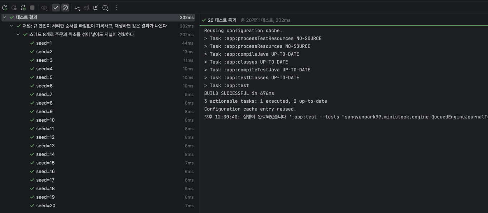

# 큐 엔진의 순서 기록과 재생 검증

- 날짜: 2026-10-29
- 관련: QueuedEngineJournalTest, 블로그 #3

## 1. 질문
큐 + 단일 전담 스레드 구조에서, 순서가 정해지는 순간(큐에 들어간 순간)을
순번으로 기록하고, 그 기록만으로 처리 결과를 다시 만들 수 있는가?

## 2. 방법
- 워커가 큐에서 명령을 꺼낼 때 순번을 1씩 늘려 저널에 기록한 뒤 처리
- 주문 1,000개, 스레드 8개, 30% 확률로 자기 주문 취소, seed 1~20
- 확인할 것
    1. 순번이 1부터 빠짐없이 이어진다
    2. 저널 기록 수 = 보낸 주문 수 + 보낸 취소 수
    3. 보낸 주문은 OrderRecord로, 보낸 취소는 CancelRecord로 한 번씩 기록된다
    4. 저널을 순번 순서대로 새 OrderBook에 스레드 하나로 재생하면,
       체결 결과와 호가창(같은 가격 안의 대기 순서 포함)이 원래 실행과 같다

## 3. 1차 결과: 실패
- 1~3번은 통과, 4번에서 실패
- 재생한 체결 결과가 0개 (원래 실행은 수백 개)

## 4. 원인
- OrderRecord가 Order 원본 객체 주소를 그대로 가리켜서, 기록 이후 체결로 바뀐 최종 상태가 남아 있었다.
- 원래 실행에서 체결된 주문은 수량이 0이 되어, 재생할 때 order()에 넣어도 아무것도 처리되지 않았다.
- 수량이 남은 주문은 호가창에 남아 있던 주문뿐인데, 이들은 원래부터 서로 체결되지 않는 가격이라 재생해도 체결이 생기지 않았다.

## 5. 수정
- OrderRecord가 Order 대신 바뀌지 않는 값(symbol, orderType, price, count, orderId)을 담도록 변경
- 기록할 때: OrderRecord.of(sequence, order)로 그 순간의 값을 복사
- 재생할 때: record.toOrder()로 새 Order를 만들어 사용

## 6. 결과
seed 1~20 모두 통과

## 7. 결론
- 공정 락은 순서가 정해지는 락 내부 대기 줄을 기록할 수 없어, 순서를 지켰는지 간접적으로만 뒷받침할 수 있었다.
- 큐 + 단일 전담 스레드 구조에서는 순서가 정해지는 지점(큐)에서 꺼낸 순서대로 순번을 붙여 기록할 수 있었다.
- 그 기록만으로 새 호가창에 재생했을 때 체결 결과와 호가창이 원래와 같았으므로 엔진이 기록된 순서 그대로 처리했음을 직접 확인했다.
- 이 기록은 이후 장애 복구(저널 재생)의 기반이 된다.

## 8. 한계
- 저널은 메모리에만 있다. 실제 장애(프로세스 종료) 후 복구는 영속화 단계에서 확인
- createdAt(접수 시각)은 기록하지 않았다. 재생하면 재생 시각으로 찍힌다.